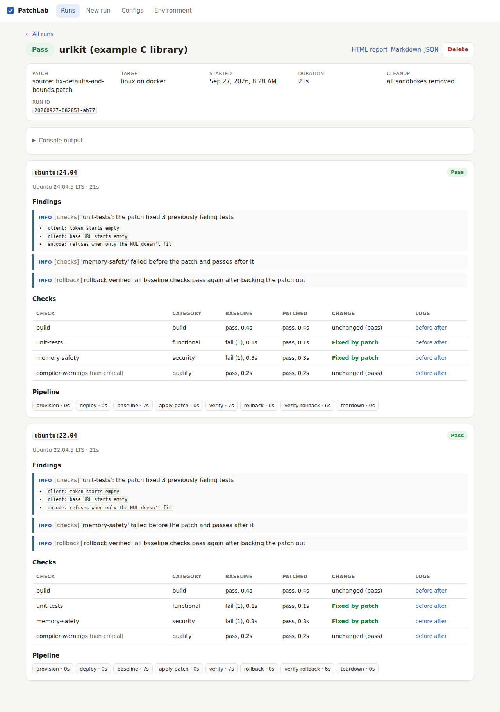

# PatchLab Internal: rapid patch testing in disposable sandboxes

[](https://github.com/andyt19911/patchlab-internal/actions/workflows/ci.yml)

AI-assisted vulnerability discovery is shortening the time between a bug being
found and an exploit existing. That makes the traditional approach (patch a
staging box, wait a week, have someone click around, then roll out) too slow.
PatchLab Internal automates the "will this patch break us?" question so it takes minutes:

```
 provision ──► baseline ──► apply patch ──► verify ──► (rollback) ──► compare ──► report ──► teardown
 fresh          run checks    source diff /    same         back it out    diff the     JSON / MD   always,
 sandbox per    + capture     OS updates /     checks +     and re-check   two runs     / HTML      even on
 target image   OS state      vendor pkg /     OS state                                             crash/^C
                              script
```

The key idea is **differential testing**. Every check runs twice, before and
after the patch, in the *same* sandbox, so the report separates failures the
patch *caused* from ones that were already there. You don't need a perfectly
green test suite to start using it.

## How organisations do this, and where PatchLab Internal fits

Mature patch pipelines usually combine these layers:

| Layer | What it answers | Common tooling |
|---|---|---|
| **Ephemeral test environments** built from golden images / IaC | Does it install and does the app still work? | Docker/Podman, Packer, Terraform, Vagrant, Molecule, Test Kitchen |
| **Automated verification** | Did anything regress? | App test suites, smoke tests, Goss/Testinfra/InSpec, synthetic transactions |
| **Snapshot + rollback testing** | Can we back it out safely? | VM/cloud snapshots, package pinning, blue/green images |
| **Ring / canary deployment** | Does it break under real load? | WSUS/Intune/Autopatch rings, SSM Patch Manager, Azure Update Manager, Kubernetes canaries, feature flags |
| **Observability gates** | Is production healthy afterwards? | Error rates, SLOs, automatic rollback triggers |

PatchLab Internal covers the first three layers: fast, repeatable, pre-production
evidence you can attach to a change ticket. It doesn't replace canary rings,
which catch problems only real traffic and data reveal. What it does is stop
obviously bad patches before they reach ring 0, and give CAB/change approvers
a report instead of a gut feeling.

## Installing

```bash
pip install .              # the core: standard library only
pip install ./web          # optional browser front end (see below)
patchlab-internal setup             # choose report/config folders and optional features
```

You can also run everything straight from a checkout with `python -m patchlab_internal`.

## Web front end (optional)



A browser UI to start runs, watch them live, cancel them, and read results. It's a
**separate package** in `web/` that the core never imports, and it's **off unless you
enable it**, either at setup (`patchlab-internal setup --web`) or later (`patchlab-internal web enable`).
Start it with `patchlab-internal web`. It listens on localhost with a per-session access token.
See [web/README.md](web/README.md).

## Windows (Hyper-V and vSphere)

Windows patching is where most organisations struggle, and containers can't
help there: Windows containers share the host kernel and are never patched
in place. So PatchLab Internal tests Windows in **disposable VMs**:

- **Hyper-V** for the lab. Sandboxes boot from differencing disks on top of
  golden VHDX images, and PatchLab Internal talks to them over PowerShell Direct, so no
  network or WinRM setup is needed.
- **vSphere** for production. Sandboxes are linked clones of template-VM
  snapshots, reached through VMware Tools guest operations.

A Windows run:
1. installs the updates **Windows Update for Business / Autopatch would install**
   (security, critical and cumulative updates; no previews, drivers or feature upgrades),
   pulling straight from Microsoft;
2. handles the reboot cycles;
3. re-runs your checks (Pester, HTTP, SQL, scripts) and compares services, the event log,
   drivers, ports, the component store, hardening registry keys and config files;
4. then uninstalls the update to prove the back-out plan works.

```powershell
# elevated prompt on the Hyper-V host
$env:PATCHLAB_INTERNAL_GUEST_PASSWORD = (Get-Credential Administrator).GetNetworkCredential().Password
python -m patchlab_internal run examples\windows\hyperv.toml --patch windows-update --verify-rollback
python -m patchlab_internal run examples\windows\hyperv.toml --patch windows-update:KB5044281   # one KB
python -m patchlab_internal run examples\windows\hyperv.toml --patch package-file:C:\Updates\kb5044281.msu
```

`examples/windows/Invoke-PatchTuesday.ps1` automates this every Patch Tuesday
and publishes the verdict to a file share, the event log and Teams. Before
Autopatch's Test ring gets the update, you know whether it breaks your builds.

**Read [docs/WINDOWS.md](docs/WINDOWS.md)** for golden image preparation,
host setup, vSphere permissions, writing checks, and the current status
(the Hyper-V/vSphere providers are new and still need a first run on real
infrastructure).

## Cloud assets (AWS, Azure, GCP, OCI)

PatchLab Internal can clone a **real production instance** and test the patch on the
copy:

1. It connects with your existing `aws` / `az` / `gcloud` / `oci` CLI login.
2. It copies the running asset's disks without touching the asset itself.
3. It boots the copy in an isolated subnet with no public IP.
4. It runs the baseline, patch, reboots and verification steps above, for Windows or Linux.
5. It reports, then deletes every resource it created.

Commands reach the clone through each cloud's own channel: SSM, Run Command,
IAP SSH or the OCI agent, so no inbound network access is needed.

```bash
python -m patchlab_internal run examples/cloud/aws-windows.toml --verify-rollback
python -m patchlab_internal run examples/cloud/gcp-linux.toml --patch os-packages
```

A clone carries production data, so **read [docs/CLOUD.md](docs/CLOUD.md)** for
the isolation requirements and per-cloud permissions before a first run.

## Quick start (Linux / containers)

Requirements: Python 3.11+ (standard library only) and a working Docker daemon.

```bash
cd patchlab-internal

# A real fix for the bundled urlkit library: expect PASS
python -m patchlab_internal run examples/urlkit/patchlab.toml \
    --patch source:examples/urlkit/patches/fix-defaults-and-bounds.patch --verify-rollback

# A plausible-looking change that breaks behaviour: expect FAIL
python -m patchlab_internal run examples/urlkit/patchlab.toml \
    --patch source:examples/urlkit/patches/always-send-auth-header.patch

# Every pending OS security/bug-fix update, with the app re-tested on top
python -m patchlab_internal run examples/urlkit/patchlab.toml --patch os-packages

# Simulated bad OS update: removes a shared library and edits /etc
python -m patchlab_internal run examples/urlkit/patchlab.toml --image ubuntu:24.04 \
    --patch script:examples/urlkit/patches/simulate-broken-os-update.sh \
    --verify-rollback --rollback "apt-get install -y zlib1g"
```

Reports are written to `reports/<run-id>/`:

- `report.html` is for people: verdict, findings, check comparison, package changes, and links to every command log.
- `report.md` is for pasting into tickets, PRs and chat.
- `report.json` is for machines: CI gates, SIEM/CMDB/ITSM ingestion, dashboards.
- `<target>/{setup,baseline,patched,rollback}/*.log` holds the full output of every command.

Exit codes: `0` PASS (or WARN), `1` FAIL (or WARN with `--fail-on-warn`),
`2` ERROR (the test couldn't complete, so the result is inconclusive), `64` config error.

### Results from the bundled example

These are real runs of the bundled urlkit example (a small C library that ships with
two real bugs; see [examples/urlkit](examples/urlkit/README.md)) on `ubuntu:24.04` and `ubuntu:22.04`:

| Patch | Verdict | What PatchLab Internal found |
|---|---|---|
| `fix-defaults-and-bounds.patch` | ✅ PASS | Fixes 3 previously failing tests and an AddressSanitizer heap-buffer-overflow on both distros; rollback verified |
| `always-send-auth-header.patch` | ❌ FAIL | Regresses `login: no Authorization header`, and separates it from the 3 tests and the sanitizer report that were already failing |
| `os-packages` | ⚠️ WARN | 2 packages upgraded on 24.04, 7 on 22.04; app unaffected; the only warnings are the pre-existing failures |
| `simulate-broken-os-update.sh` | ❌ FAIL | Build broken, 67 binaries with unresolvable libraries, package DB broken, **and the planned rollback fails because apt itself is broken** |

The last row shows why rollback testing matters: the back-out plan
"just reinstall the package" doesn't work when the update breaks the
package manager.

On a warm cache, a full run on two distros (setup, baseline, patch, verify,
rollback, report and teardown) takes about 25 seconds.

## Configuration

A config describes the environment and the checks. The patch is usually
passed on the command line so the same config can test any patch.

```toml
name = "my-service"
services = ["service nginx restart"]   # (re)started before each phase; top-level key

[sandbox]
images  = ["ubuntu:24.04", "ubuntu:22.04", "rockylinux:9"]  # tested in parallel
memory  = "2g"
cpus    = "2"
network = "bridge"        # "none" for fully offline checks (then no OS-package patches)
setup   = [               # run once per image, then cached as a local image
  "apt-get update -q",
  "apt-get install -y -q nginx curl",
]

[[deploy]]                # copy your app / tests / fixtures into the sandbox
src = "../"
dest = "/opt/app"
exclude = [".git", "node_modules"]

[[checks]]
name = "http-smoke"
category = "smoke"
run = "curl -fsS http://localhost/health"
timeout = 30

[[checks]]
name = "unit"
run = "cd /opt/app && pytest --junitxml=/tmp/junit.xml"
results = "junit:/tmp/junit.xml"   # or "tap" to parse stdout; enables per-test diffs
perf_tolerance = 0.5               # WARN if >50% slower after the patch

[[checks]]
name = "lint"
run = "..."
critical = false                   # regressions here WARN instead of FAIL

[health]                           # built-in OS probes (on by default)
watch_paths    = ["/etc"]          # hash these to detect overwritten config
lib_scan_paths = ["/usr/bin", "/usr/sbin", "/usr/local/bin", "/opt/app/bin"]
ignore_files   = ["/etc/ld.so.cache"]

[patch]                            # optional default patch; --patch overrides it
kind = "os-packages"
packages = ["openssl", "libssl3"]
rollback = "apt-get install -y --allow-downgrades openssl=3.0.13-0ubuntu3 libssl3=3.0.13-0ubuntu3"
```

Validate a config without running anything: `python -m patchlab_internal validate my.toml`.

### Code with dependencies and services

For application code rather than OS packages (see
[`examples/services`](examples/services/patchlab.toml)):

```toml
[sandbox]
images  = ["node:20-bookworm"]
workdir = "/src/app/backend"            # where install commands and checks start
install = ["npm ci"]                    # after deploy, after the patch, after the rollback
check_network = "isolated"              # checks reach the sidecars and nothing else
ca_bundle = "/etc/ssl/corp-bundle.crt"  # optional: trust a TLS-inspecting proxy

[[sidecars]]                            # reachable from checks as host "postgres"
name   = "postgres"
image  = "postgres:16"
env    = { POSTGRES_PASSWORD = "throwaway" }
health = "pg_isready -U postgres"

[[mirrors]]                             # a private git dependency, without a token
path = "/var/lib/mirrors/core.git"      # a bare repo the host fetched
urls = ["ssh://git@github.com/Org/core.git", "https://github.com/Org/core.git"]
```

`run --no-patch` runs the checks once on the code as it is (a health check).

### Patch kinds

| `--patch` | Use for | Applied with |
|---|---|---|
| `source:fix.patch[,more.patch]` | Code fixes, backports, dependency bumps | `git apply` / `patch -p1` in the first deploy dir (auto-reversed for rollback) |
| `os-packages` | "Patch Tuesday": every pending OS update | `apt-get dist-upgrade` / `dnf upgrade` / `apk upgrade` (keeps local config files) |
| `os-packages:openssl,libssl3` | Emergency CVE fix for specific packages | Targeted upgrade |
| `package-file:vendor.deb` | Vendor-supplied hotfix packages | `apt-get install ./x.deb` / `dnf install ./x.rpm` |
| `script:hotfix.sh` | Anything else: installers, config hardening, agent updates | Runs the script as root |

### What the built-in OS health probes detect

- **Packages** upgraded, added or removed (removals raise a WARN).
- **Package database damage**: `dpkg --audit`, `apt-get check`, `dnf check`.
- **Broken shared libraries**: binaries whose `ldd` dependencies no longer resolve.
- **Services**: TCP ports that stopped listening (FAIL) or newly appeared (WARN).
- **Configuration drift**: files under `watch_paths` that were modified or deleted.

### Verdicts

| Verdict | Meaning |
|---|---|
| PASS | Nothing regressed. |
| WARN | Something needs a human look: a non-critical regression, a slowdown, removed packages, a new open port, a pre-existing failure, or an unverified rollback. |
| FAIL | The patch broke something: a critical check regressed, a test case regressed, the patch didn't apply, libraries broke, a service stopped, or the rollback failed. |
| ERROR | The test couldn't run (image pull, setup, sandbox or cancellation), so the result is inconclusive. It is never reported as a pass. |

## Cleanup guarantees

- Each sandbox is created and removed inside a context manager; teardown runs even when a stage throws.
- Ctrl-C / SIGTERM cancels the run, force-removes that run's containers and still writes a partial report.
- Every container is labelled `patchlab_internal=1` and `patchlab_internal.run=<id>`. After each run, any leftovers with the run label are removed.
- If the process is killed with `kill -9`, `python -m patchlab_internal gc` removes all orphaned sandboxes. `gc --cache` also removes cached setup images.
- `--keep-on-failure` deliberately keeps failing sandboxes and prints the `docker exec` command to get into them.

Sandboxes run with memory, CPU and PID limits and `no-new-privileges`.
Patches and checks are still arbitrary code running as root in a container, so
only test patches from sources you would run on a build server, and use
`network = "none"` where the checks don't need network access.

## Keeping an estate up to date

`patchlab-internal estate` is the control plane on top of the engine: it keeps
the repositories listed in [`estate.toml`](estate.toml) up to date and tested.

```bash
patchlab-internal estate validate                  # the manifest; refuses real credentials
patchlab-internal estate sync                      # fetch the repos and private-dependency mirrors
patchlab-internal estate scan subsovereign/backend # advisories and the changes that would fix them
patchlab-internal estate propose subsovereign/backend nodemailer   # build, test, triage
patchlab-internal estate health                    # every package's checks on the current code
patchlab-internal estate digest                    # what needs a person, from the state files
patchlab-internal estate cycle                     # all of the above: the nightly job
```

A proposal is the smallest version change that fixes every known advisory,
built without running any dependency code, tested before and after (and after
rolling back) in a sandbox with its services, and then put through a gate that
fails closed: nothing regressed, no test lost, rollback verified, advisories
gone, none introduced, only the manifest and lockfile changed. Read
[docs/DESIGN.md](docs/DESIGN.md) for the lifecycle, the gate and what it can't
guarantee, and [deploy/systemd](deploy/systemd) to run it nightly.

## CI integration

See [`examples/ci/github-actions.yml`](examples/ci/github-actions.yml). It runs
PatchLab Internal on every PR that touches `patches/`, uploads the HTML report as an
artifact, and posts the Markdown report as a job summary. The same pattern
works in GitLab CI, Jenkins or Azure Pipelines: run PatchLab Internal, gate on the exit
code, and keep the report.

A typical emergency flow for a new CVE:

1. A scanner or advisory feed opens a ticket, e.g. "CVE-XXXX in openssl".
2. Automation runs `patchlab-internal run app.toml --patch os-packages:openssl,libssl3 --verify-rollback` across every OS image in the estate.
3. On PASS, the JSON report is attached to the change request and the patch goes to canary ring 0 automatically.
4. On FAIL, the ticket gets the Markdown report and a pointer to the logs, and the patch doesn't move.

## Limits and extending it

- **Linux containers share the host kernel.** Kernel, driver, bootloader and
  systemd changes need a VM. The Windows VM path (`patchlab_internal/windows.py` plus
  `patchlab_internal/ps/provider-*.ps1`) shows the pattern: a provider implements
  create / exec / copy / checkpoint / restore / destroy. A KVM/libvirt or
  cloud (EC2/Azure) provider for Linux VMs would follow the same shape.
- **Tests are only as good as your checks.** Start with smoke tests (does it
  start, does `/health` respond, can it log in), then add your existing unit
  and integration suites. Emitting JUnit or TAP gives per-test regression reports.
- **Some regressions only show up with production data and traffic.** Keep
  canary rings and monitoring as the next gate.

## Development

This repository (`andyt19911/patchlab-internal`) is where PatchLab Internal is developed and
tested. It is for internal use only and is not published.

```bash
cd patchlab-internal
python -m unittest discover -s web/tests # the optional front end's tests
python -m unittest discover -s tests     # no Docker, Windows or cloud account needed;
                                         # pwsh enables the PowerShell tests, and installed
                                         # aws/az/oci CLIs enable command-syntax validation
python -m patchlab_internal run examples/windows/local-dev.toml \
    --patch script:examples/windows/local/patches/bad-hotfix.ps1   # Windows pipeline, no VM
```

Layout:

```
patchlab_internal/
  patchlab_internal/cli.py       command line (run / validate / gc)
  patchlab_internal/config.py    TOML config + patch specs
  patchlab_internal/sandbox.py   disposable Docker sandboxes, cache, cleanup
  patchlab_internal/probes.py    OS health snapshot (packages, libs, ports, config)
  patchlab_internal/results.py   TAP / JUnit parsing
  patchlab_internal/compare.py   baseline vs patched diff -> findings -> verdict
  patchlab_internal/runner.py    pipeline orchestration, parallel targets, signals
  patchlab_internal/report.py    JSON / Markdown / HTML reports
  patchlab_internal/linux.py     Linux platform: Docker sandboxes, shell patch commands
  patchlab_internal/windows.py   Windows platform: PowerShell driver, reboots, rollback, probe parsing
  patchlab_internal/cloud/       AWS / Azure / GCP / OCI clone providers and the shared cloud sandbox
  patchlab_internal/ps/          PowerShell: driver, Hyper-V/vSphere/local providers, guest scripts
                        (Windows Update install, SYSTEM task wrapper, health probe, uninstall)
  examples/urlkit/      Linux example: a small C library, its tests and patches
  examples/windows/     Hyper-V/vSphere configs, Pester checks, Patch Tuesday scheduler
  examples/cloud/       AWS/Azure (Windows) and GCP/OCI (Linux) clone configs
  examples/ci/          CI pipeline example
  docs/WINDOWS.md       Windows setup and operating guide
  docs/CLOUD.md         cloud cloning: isolation, permissions, per-cloud setup
  docs/ROADMAP.md       where PatchLab Internal goes next: phases, priorities, metrics
  docs/ESTATE_SURVEY.md the six repos it maintains: stack, CI, audits, gaps
  docs/DESIGN.md        estate maintenance design: updates, build health, drift, dashboard
  patchlab_internal/settings.py  settings written by `patchlab-internal setup` / `patchlab-internal web enable|disable`
  web/                  OPTIONAL front end package (patchlab_internal_web): server, static UI, tests
  tests/                unit and integration tests
```

## Licence

Proprietary, internal use only; see [LICENSE](LICENSE). Not for distribution
outside MIIMAGINELabs. The bundled example library in `examples/urlkit` keeps
its own MIT licence.
