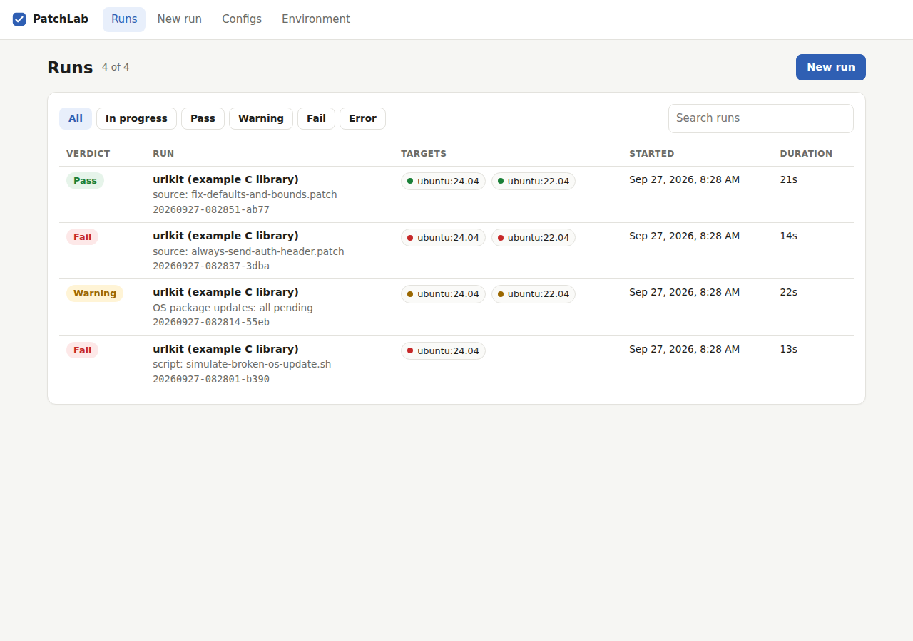

# PatchLab Internal web front end (optional)

A browser UI for PatchLab Internal. It lets you:
- start runs;
- follow their output live;
- cancel them (sandboxes are still cleaned up);
- read results;
- browse and validate configs;
- clean up leftovers;
- check which tools the machine has.



It's a **separate package** (`patchlab_internal_web`) and it's **off by default**:

- The core `patchlab_internal` package never imports it. The front end drives the core only through
  `python -m patchlab_internal ...` processes and the report files they write. Runs started from the
  browser behave exactly like runs typed at a terminal, and runs started from the terminal
  show up in the browser.
- It uses only the Python standard library and plain HTML/CSS/JS: no Node, no build step.

## Enable it

```bash
pip install . ./web              # core + front end (from a checkout, `pip install ./web` is optional)

patchlab-internal setup --web             # at setup time (or run `patchlab-internal setup` for the interactive questions)
patchlab-internal web enable              # ...or any time later; `patchlab-internal web disable` turns it off again

patchlab-internal web                     # start it; open the printed link
patchlab-internal web status              # enabled? installed? where do reports/configs live?
```

`patchlab-internal setup` also chooses the **reports folder** (where every run, from the CLI or the
browser, writes its report) and the **configs folder** (where the front end looks for
`.toml` configs). Settings live in `~/.config/patchlab_internal/settings.toml`
(`%APPDATA%\PatchLabInternal\settings.toml` on Windows, or `$PATCHLAB_INTERNAL_HOME`).

## Estate results

The **Estate** page shows what `patchlab-internal estate` found and proposed: package health,
advisories and code findings, container images, CI workflows, and every tested change with its
gate, pull request text and patch. It is read-only and reads the estate's `state/` folder, so it
never scans, publishes or touches a managed repo. Point it at the manifest with
`patchlab-internal web --estate estate.toml` (or `PATCHLAB_INTERNAL_ESTATE_MANIFEST`, or put
`estate.toml` in the configs folder). To review a nightly GitHub Actions run, download its
`estate-<run id>` artifact, unzip it into a folder named `state`, and start the front end with
`PATCHLAB_INTERNAL_ESTATE_WORKDIR` set to the folder that holds `state`.

## Security

The front end can start runs that clone production systems with the credentials of the
user who started it, so:

- It listens on **127.0.0.1 only**. Use an SSH tunnel to reach it from elsewhere.
  `--allow-remote` is required to bind any other address.
- Every session needs the **access token** in the link that `patchlab-internal web` prints. The token is
  swapped for an `HttpOnly`, `SameSite=Strict` cookie and removed from the address bar.
- State-changing requests need an `X-PatchLabInternal-Request` header, which cross-site pages can't send.
- The `Host` header must name the server (a DNS-rebinding defence).
- Pages use a strict Content-Security-Policy with no inline script, and all data is rendered as text.
- Report and log files are served only from inside the reports folder, and configs only from the configs folder.
- A guest password typed into the *New run* form is handed only to that run's process
  (as `PATCHLAB_INTERNAL_GUEST_PASSWORD`). It's never written to disk or shown again.

Runs inherit the environment the server started with: cloud CLI logins, `PATCHLAB_INTERNAL_*` secrets
and so on. Stopping the server with Ctrl-C cancels active runs and waits for their clean-up.

## API

The UI is a thin client over a small JSON API, handy for scripts. Authenticate with
`Authorization: Bearer <token>`, and send `X-PatchLabInternal-Request: 1` on POST and DELETE.

| Method | Path | |
|---|---|---|
| GET | `/api/runs` | all runs (reports folder + runs in progress) |
| POST | `/api/runs` | start `{config, patch?, images?, verify_rollback?, keep_on_failure?, fail_on_warn?, guest_password?}` |
| GET | `/api/runs/<id>` | report, files and job status |
| GET | `/api/runs/<id>/console?offset=N` | live output from byte `N` |
| POST | `/api/runs/<id>/cancel` | cancel (sandboxes are still cleaned up) |
| DELETE | `/api/runs/<id>` | delete a finished run's folder |
| GET | `/api/configs`, `/api/config?path=` | list and inspect configs |
| POST | `/api/gc` | `{config}`: remove leftovers for that config's provider |
| GET | `/api/environment`, `/api/session` | tools, settings, versions |
| GET | `/api/estate` | estate results: packages, images, CI workflows, every decision |
| GET | `/api/estate/decision?id=`, `/api/estate/digest?date=` | one decision's gate, PR text and patch; a digest |
| GET | `/files/<id>/<path>` | report files and logs |

## Tests

```bash
python -m unittest discover -s web/tests     # add Playwright + Chromium for the browser test
```
